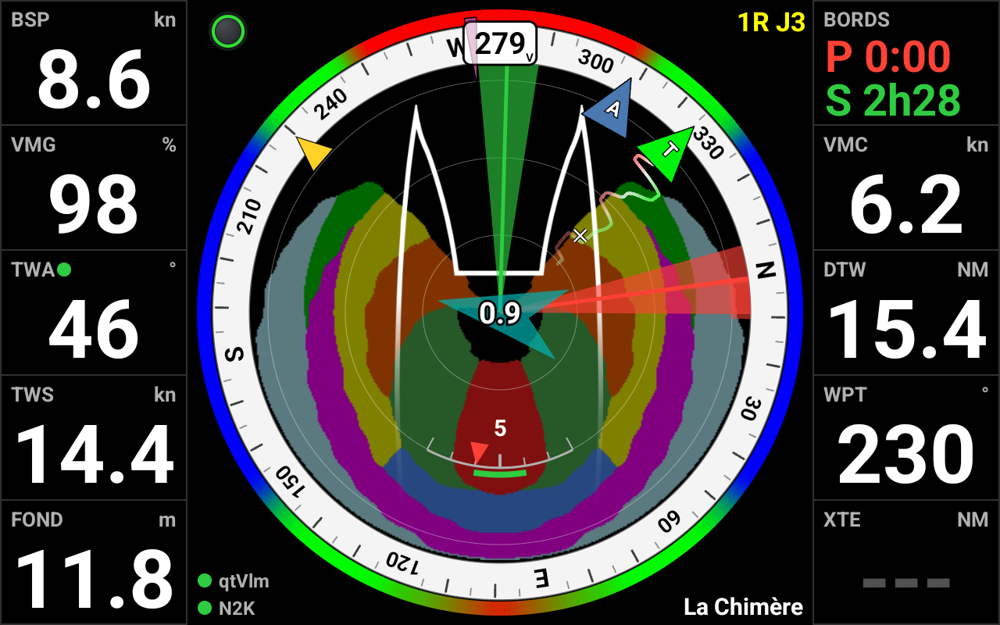

# n2kdran — répétiteur d'instruments NMEA 2000

[English](README.md) · **Français**

n2kdran affiche sur une tablette Android (ou dans un navigateur) les instruments
du bord diffusés en Wi-Fi par une passerelle NMEA 2000. Il y ajoute une aide à la
marche du bateau : cibles de polaire, laylines corrigées du courant, route vers le
waypoint, surveillance AIS.



- **Rose** tournante sur le cap : vent apparent et vrai, COG, courant, relèvement
  du waypoint, cercle des allures coloré selon la polaire.
- **Laylines** au cap et au fond (corrigées du courant et de la dérive estimée),
  avec historique.
- **Cibles de polaire** (vitesse cible, angle de VMG optimum), % polaire, VMG, VMC.
  Polaire au format qtVlm (`.pol` / `.csv`).
- **Sail chart** qtVlm (`.saildef` + `.sailselect`) : voile conseillée.
- **10 cases** configurables (vitesse, vent, profondeur, loch, temps et distance
  au waypoint, bords…).
- **AIS** : cible la plus menaçante (CPA / TCPA), alarme sonore, balises de
  détresse (AIS-SART, MOB, EPIRB) et homme à la mer N2K (127233).
- **Données jamais figées** : une donnée non reçue depuis le délai de péremption
  s'affiche « --- ».
- Mode nuit, écran maintenu allumé, état des connexions visible en permanence.

Mise en page prévue pour une tablette 10" en 1280×800 paysage (SailProof SP10X) ;
Android 13 minimum.

Le **[manuel utilisateur](docs/manuel/n2kdran-manuel.pdf)** (PDF, en français)
décrit l'écran, les réglages et la mise en service.

## Sources de données

- **NMEA 2000** : tout appareil qui diffuse le bus en TCP au format **YDRAW**
  (format « RAW » de Yacht Devices : `hh:mm:ss.ddd R <ID> <octets>`), par exemple
  [n2k-mux](https://github.com/ozolli/n2k-mux) (port 2700). Seul n2k-mux a été
  essayé.
- **Navigation** (waypoint actif, écart de route) : qtVlm, en UDP (port 2800),
  sorties RMB / WPL / XTE converties en PGN 129284 / 129285 / 129283.

n2kdran **n'émet rien** sur le bus.

## Version web

Le même écran dans un navigateur d'ordinateur (Linux, Raspberry Pi…) : le cœur C
est compilé en WebAssembly et un petit relais Python (bibliothèque standard seule)
transmet le flux à la page. Il lit une source YDRAW en TCP ou directement un bus
CAN (`can:can0`, lecture seule). Voir [web/LISEZMOI.txt](web/LISEZMOI.txt) et le
chapitre 9 du manuel.

```sh
python3 web/relay.py --n2k <hôte>:2700      # ou --n2k can:can0
# puis http://localhost:8090/
```

## Compilation

Structure :

| Dossier | Contenu |
|---|---|
| `libn2k/` | Cœur en C11 sans I/O ni dépendance : lecture YDRAW, fast-packets, décodage des PGN, choix de source, calculs (polaire, laylines, courant, dérive, AIS). Tests et outil `n2kdump`. |
| `app/` | Application Android : couche JNI + Kotlin (connexion, affichage `DashboardView`). |
| `web/` | Version web : pont WebAssembly, page, relais. |
| `tests/data/` | Captures de référence (simulateur ; capture réelle anonymisée), polaire et sail chart CM50. |
| `docs/` | Manuel (HTML → PDF) et icône. |

Cœur C et tests (Linux) :

```sh
cmake -S libn2k -B libn2k/build && cmake --build libn2k/build
(cd libn2k/build && ctest)
nc <hôte> 2700 | libn2k/build/n2kdump      # décodage en direct
```

Application Android (sans Android Studio) : JDK 17, SDK Android (`platforms;android-36`,
`build-tools;36.0.0`), NDK `28.2.13676358`, CMake `3.31.6` ; chemin du SDK dans
`local.properties` (`sdk.dir=…`).

```sh
./gradlew assembleDebug        # app/build/outputs/apk/debug/app-debug.apk
```

`./gradlew distApk` produit un APK de version signé si les propriétés
`N2KDRAN_KEYSTORE`, `N2KDRAN_KEY_ALIAS` et `N2KDRAN_KEY_PASSWORD` sont définies
(par exemple dans `~/.gradle/gradle.properties`).

Version web (emscripten) : `sh web/build.sh` régénère `web/n2k.js` et
`web/n2k.wasm` (fournis compilés).

## Avertissement

n2kdran est une aide à la navigation écrite pour un bateau précis. Il ne remplace
ni la veille, ni les instruments et la carte du bord. Les alarmes AIS dépendent de
la réception et de la qualité des données : ne pas compter sur elles seules.

## Licence

[Apache 2.0](LICENSE).
