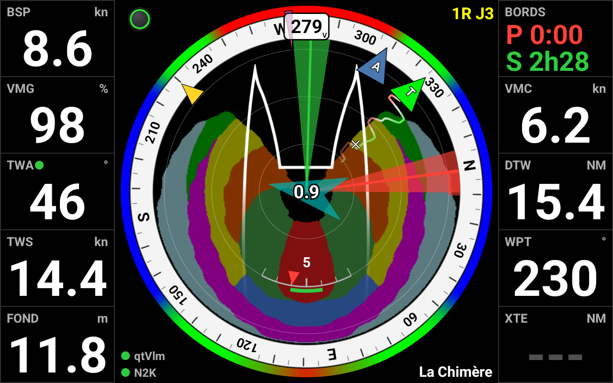

# n2kdran — NMEA 2000 instrument repeater

**English** · [Français](README.fr.md)

n2kdran shows the boat's instruments, broadcast over Wi-Fi by a NMEA 2000 gateway,
on an Android tablet (or in a web browser). On top of that it helps you sail the
boat: polar targets, current-corrected laylines, route to the waypoint, AIS watch.

The user interface and the manual are in French.



- **Rose** rotating with the heading: apparent and true wind, COG, current,
  bearing to waypoint, wind-angle ring coloured from the polar.
- **Laylines** through the water and over the ground (corrected for current and
  estimated leeway), with history.
- **Polar targets** (target speed, optimum VMG angle), polar %, VMG, VMC.
  qtVlm polar format (`.pol` / `.csv`).
- qtVlm **sail chart** (`.saildef` + `.sailselect`): suggested sail.
- **10 configurable cells** (speed, wind, depth, log, time and distance to
  waypoint, tacks…).
- **AIS**: most dangerous target (CPA / TCPA), audible alarm, distress beacons
  (AIS-SART, MOB, EPIRB) and N2K man overboard (127233).
- **Never frozen data**: anything not received within the stale timeout shows
  as "---".
- Night mode, screen kept on, connection status always visible.

Layout designed for a 10" tablet, 1280×800 landscape (SailProof SP10X);
Android 13 or later.

The **[user manual](docs/manuel/n2kdran-manuel.pdf)** (PDF, in French) covers the
screen, settings and setup.

## Data sources

- **NMEA 2000**: any device streaming the bus over TCP in **YDRAW** format
  (Yacht Devices "RAW": `hh:mm:ss.ddd R <ID> <bytes>`), for instance
  [n2k-mux](https://github.com/ozolli/n2k-mux) (port 2700). Only n2k-mux has been
  tried.
- **Navigation** (active waypoint, cross-track error): qtVlm over UDP (port 2800),
  RMB / WPL / XTE outputs converted to PGN 129284 / 129285 / 129283.

n2kdran **never transmits** on the bus.

## Web version

The same screen in a desktop browser (Linux, Raspberry Pi…): the C core is
compiled to WebAssembly and a small Python relay (standard library only) feeds the
page. It reads a YDRAW TCP source or a CAN bus directly (`can:can0`, read-only).
See [web/LISEZMOI.txt](web/LISEZMOI.txt) and chapter 9 of the manual.

```sh
python3 web/relay.py --n2k <host>:2700      # or --n2k can:can0
# then http://localhost:8090/
```

## Building

Layout:

| Directory | Contents |
|---|---|
| `libn2k/` | C11 core, no I/O, no dependencies: YDRAW parsing, fast-packets, PGN decoding, source selection, computations (polar, laylines, current, leeway, AIS). Tests and the `n2kdump` tool. |
| `app/` | Android app: JNI layer + Kotlin (connection, `DashboardView` display). |
| `web/` | Web version: WebAssembly bridge, page, relay. |
| `tests/data/` | Reference captures (simulator; anonymised real capture), CM50 polar and sail chart. |
| `docs/` | Manual (HTML → PDF) and icon. |

C core and tests (Linux):

```sh
cmake -S libn2k -B libn2k/build && cmake --build libn2k/build
(cd libn2k/build && ctest)
nc <host> 2700 | libn2k/build/n2kdump      # live decoding
```

Android app (no Android Studio needed): JDK 17, Android SDK (`platforms;android-36`,
`build-tools;36.0.0`), NDK `28.2.13676358`, CMake `3.31.6`; SDK path in
`local.properties` (`sdk.dir=…`).

```sh
./gradlew assembleDebug        # app/build/outputs/apk/debug/app-debug.apk
```

`./gradlew distApk` builds a signed release APK when the `N2KDRAN_KEYSTORE`,
`N2KDRAN_KEY_ALIAS` and `N2KDRAN_KEY_PASSWORD` properties are set (for instance in
`~/.gradle/gradle.properties`).

Web version (emscripten): `sh web/build.sh` regenerates `web/n2k.js` and
`web/n2k.wasm` (shipped prebuilt).

## Disclaimer

n2kdran is a navigation aid written for one particular boat. It does not replace
a proper lookout, the boat's own instruments or the chart. AIS alarms depend on
reception and data quality: do not rely on them alone.

## License

[Apache 2.0](LICENSE).
